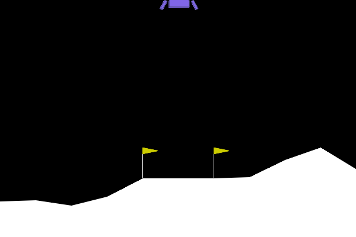

# 第11章 LunarLander：学習後のエージェントが月面に着陸する様子

[第11章の Notebook](ch11_lunarlander.ipynb) の4-3節で作った GIF です。GitHub では Notebook の中の GIF の動きが見られないため（著者が、private だった 2026-10-01 に第0章で、public にした後の 2026-10-10 に第3〜5章で確かめました）、このページで見られるようにしています。

## 学習後（Stable-Baselines3 の PPO で 1,000,000 ステップ学習した、離散の版の最後の時点のモデル）

機体は画面の上の真ん中から始まり、少し右へ流されながら下ります。そのあと、左へ戻りながらゆっくり降りて、2本の黄色い旗の間に脚を着け、そのまま止まります。機体の下や横に出る赤や橙の小さな点は、エンジンを噴いたときの描画です。4 ステップごとの絵を 1 枚 80 ミリ秒で表示しているので、ほぼ描画の速さ（1 秒に 50 ステップ）です。

絵は、Gymnasium（MIT License）の LunarLander の描画処理が出力したものです。仕様と出典は、[第11章の Notebook](ch11_lunarlander.ipynb) の末尾の「出典」の節にあります。ライセンスは、リポジトリの [LICENSE.md](../../LICENSE.md) を見てください。
