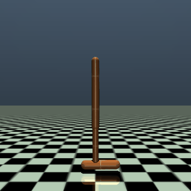
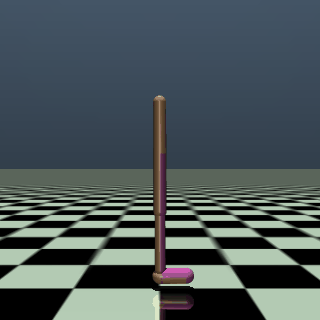

# 第13章 MuJoCo：学習後のエージェントが跳ねる様子・歩く様子

第13章の2冊の Notebook で作った GIF です。GitHub では Notebook の中の GIF の動きが見られないため（著者が、private だった 2026-10-01 に第0章で、public にした後の 2026-10-10 に第3〜5章で確かめました）、このページで見られるようにしています。どちらも、10 ステップごとの絵を 1 枚 80 ミリ秒で表示しているので、ほぼ描画の速さ（1 秒に 125 ステップ）です。画面は、胴体に合わせて動きます。

## Hopper（Stable-Baselines3 の SAC で 1,000,000 ステップ学習した、最後の時点のモデル）

[1冊目の Notebook](ch13_1_hopper.ipynb) の5-3節で作った GIF です。一本足のロボットは、まっすぐ立った姿勢から、体を進む向き（右）へ少し傾け、膝を曲げ伸ばしして、1本の脚で跳ねながら進みます。最後の 1,000 ステップまで倒れません。終わりのほうでは、床の模様が途中で切れて、その先が暗く描かれます（1冊目の5-3節）。

## Walker2d（Stable-Baselines3 の SAC で 1,000,000 ステップ学習した、最後の時点のモデル）

[2冊目の Notebook](ch13_2_walker2d.ipynb) の4-3節で作った GIF です。二本足のロボットは、2本の脚をそろえてまっすぐ立った姿勢から歩き出し、胴体を進む向き（右）へ少し傾けたまま、2本の脚を交互に前へ出して進みます。最後の 1,000 ステップまで倒れません。

絵は、Gymnasium（MIT License）の Hopper と Walker2d の環境を、MuJoCo（Apache License 2.0）の描画処理で描いたものです（体の形は Gymnasium の `hopper.xml`・`walker2d_v5.xml` で決められ、画像の素材は使っていません）。仕様と出典は、各 Notebook の末尾の「出典」の節にあります。ライセンスは、リポジトリの [LICENSE.md](../../LICENSE.md) を見てください。
